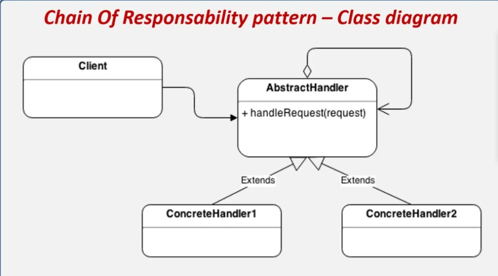
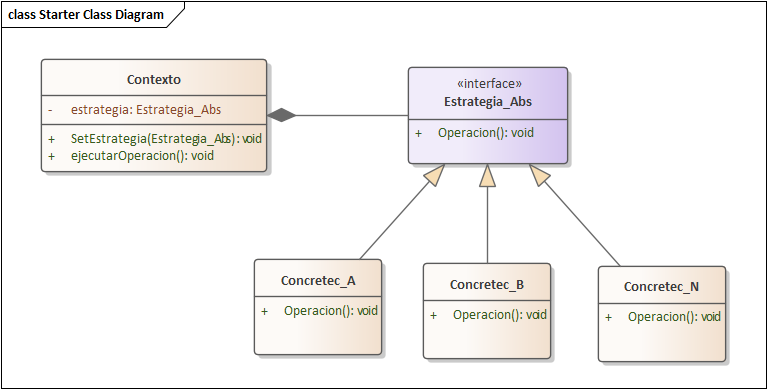

# PLAN DE IMPLEMENTACION DE PATRONES DE DISENO Y CORRECCION DE DEUDA TECNICA (SEGUNDA PARTE)

## 1. Resumen Arquitectonico del Proyecto
El sistema **Control de Asistencia Universitario** se encuentra implementado bajo el patron arquitectonico de **Microservicios** utilizando **Spring Boot 3.3.4 (Java 21)**, **Spring Cloud Gateway**, **Spring Cloud OpenFeign**, **PostgreSQL 16** con aislamiento de base de datos por servicio (`db_auth`, `db_academica`, `db_asistencia`), un panel administrativo web en **React + Vite** (`frontend-admin`) y una aplicacion movil en **Flutter** (`mobile-app`).

### 1.1. Ranking Oficial de los 7 Casos de Uso (De Mayor a Menor Complejidad)
*(Se excluyen expresamente los patrones Singleton y Fachada).*

| Orden | Caso de Uso | Microservicio | Complejidad | Patron(es) Recomendado(s) | Estado de Implementacion |
| :--- | :--- | :--- | :--- | :--- | :--- |
| **1 (Mayor)** | **CU07 - GESTIONAR ASISTENCIA** | `asistencia-service` | **Muy Alta** | **1. Chain of Responsibility** (Cadena de validaciones del marcado por Codigo QR) | **IMPLEMENTADO (Patron 1)** |
| **2** | **CU03 - GESTIONAR ESTUDIANTE** | `academico-service` | **Alta** | **1. Strategy** (Parseo polimorfico Excel, PDF y CSV) 2. Template Method | **IMPLEMENTADO (Patron 2)** |
| **3** | **CU06 - GESTIONAR BOLETA_INSCRIPCION** | `academico-service` | **Media-Alta** | 1. Specification 2. Observer | Documentado + Mejora de Cupo |
| **4** | **CU01 - GESTIONAR USUARIO-ROLES** | `auth-service` | **Media** | 1. Factory Method 2. Decorator | Documentado + Mejora Token |
| **5** | **CU05 - GESTIONAR GRUPO** | `academico-service` | **Media-Baja** | 1. Builder con validacion de invariantes 2. Mediator | Documentado |
| **6** | **CU02 - GESTIONAR DOCENTE** | `academico-service` | **Baja** | 1. Observer 2. Template Method | Documentado |
| **7 (Menor)** | **CU04 - GESTIONAR MATERIA** | `academico-service` | **Muy Baja** | 1. Decorator (Cache en memoria) 2. Template Method | Documentado |

---

## 2. Patrones de Diseno Implementados (Alineados a las Imagenes de Referencia Obligatoria)

### 2.1. Patron 1: Chain of Responsibility en `CU07 - GESTIONAR ASISTENCIA` (`asistencia-service`)

* **`Client`**: `AsistenciaServiceImpl` (mantiene referencia a `AbstractAsistenciaHandler` e invoca `+ handleRequest(request)`).
* **`AbstractHandler`**: `AbstractAsistenciaHandler` (posee auto-agregacion `# siguiente: AbstractAsistenciaHandler`, `+ setSiguiente(AbstractAsistenciaHandler)` y `+ handleRequest(AsistenciaValidationContext request)`).
* **`ConcreteHandlers` (Extends `AbstractAsistenciaHandler`)**:
  1. `SesionActivaHandler`: Valida que el codigo QR corresponda a una `SesionClase` existente y en estado `ACTIVA`.
  2. `VigenciaQrHandler`: Valida que la fecha y hora actual no superen `sesion.getExpiracionQr()`.
  3. `DuplicidadAsistenciaHandler`: Verifica en `AsistenciaRepository` que el estudiante no haya marcado asistencia previamente en la misma sesion.
  4. `InscripcionAcademicaHandler`: Consulta de manera sincrona via OpenFeign (`AcademicoFeignClient`) a `academico-service` para confirmar que el estudiante pertenece al grupo de la sesion.
  5. `CalculoPuntualidadHandler`: Evalua los minutos transcurridos desde `sesion.getHoraInicio()` con tolerancia parametrizada (`@Value("${asistencia.tolerancia-minutos:15}")`), asignando `EstadoAsistencia.PRESENTE` o `EstadoAsistencia.ATRASO`.

---

### 2.2. Patron 2: Strategy en `CU03 - GESTIONAR ESTUDIANTE` (`academico-service`)

* **`Contexto`**: `ContextoParserArchivo`
  * Atributo privado: `- estrategia: EstrategiaParserArchivo` (relacion de composicion hacia la interfaz de estrategia).
  * Metodo de asignacion: `+ setEstrategia(EstrategiaParserArchivo estrategia): void`.
  * Metodo de ejecucion: `+ ejecutarOperacion(InputStream inputStream): List<Map<String, String>>`.
* **`<<interface>> Estrategia_Abs`**: `EstrategiaParserArchivo`
  * Operacion polimorfica: `+ operacion(InputStream inputStream): List<Map<String, String>>`.
  * Identificador de soporte: `+ soportaArchivo(String nombreArchivo): boolean`.
* **`ConcreteStrategies` (Implementan `EstrategiaParserArchivo`)**:
  1. `ExcelParserConcreteStrategy` (`Concretec_A`): Procesa hojas `.xlsx` y `.xls` mediante Apache POI (`WorkbookFactory`).
  2. `PdfParserConcreteStrategy` (`Concretec_B`): Procesa padrones `.pdf` mediante Apache PDFBox (`PDFTextStripper`).
  3. `CsvParserConcreteStrategy` (`Concretec_N`): Procesa archivos `.csv` detectando BOM UTF-8, delimitadores (`,`, `;`, `\t`) y comillas escapadas.

---

## 3. Registro de Hallazgos Criticos y Deuda Tecnica Corregidos

| Codigo | Modulo / Archivo | Problema Original | Solucion Implementada |
| :--- | :--- | :--- | :--- |
| **DT-01** | `api-gateway/src/main/resources/application.yml` | Errores tipograficos `routes:l` (L9) y `AuthenticationFilterl` (L30). | Corregido a `routes:` y `name: AuthenticationFilter`. |
| **DT-02** | `AsistenciaServiceImpl.java` | Metodo `registrarAsistenciaQr` monolitico con 5 validaciones acopladas y tolerancia fija. | Refactorizado con el patron **Chain of Responsibility** y tolerancia configurable. |
| **DT-03** | `ImportacionEstudiantesServiceImpl.java` | Bifurcacion `if / else if / else` de formatos de archivo y metodos privados acoplados en una clase de 632 lineas. | Refactorizado con el patron **Strategy** (`ContextoParserArchivo` y 3 estrategias concretas). |
| **DT-04** | `SesionClaseRepository.java` y `SesionClaseServiceImpl.java` | Uso de `findAll()` en memoria y riesgo de `NullPointerException` en `codigoDocenteReferencia`. | Consultas JPQL/Spring Data (`findByEstadoOrderByIdDesc`, `findSesionesPorEstadoYDocenteOGrupo`) y manejo null-safe. |
| **DT-05** | `BoletaInscripcionRepository.java` y `BoletaInscripcionServiceImpl.java` | `inscribirEstudiante()` no verificaba disponibilidad de cupo ni inscripcion duplicada. | Agregado `countEstudiantesByGrupoId(grupoId)` y validaciones de cupo maximo y duplicidad. |
| **DT-06** | `ErrorResponseDto.java` (3 microservicios) | El backend devolvia solo `mensaje` mientras el frontend consultaba `message`. | Agregado getter `getMessage()` en `ErrorResponseDto` para exponer ambos campos en JSON. |
| **DT-07** | `RouteValidator.java` y `AuthServiceImpl.java` | `RouteValidator` usaba `.contains(uri)` y `validarToken` omitia `esTokenValido()`. | Actualizado a `.startsWith(uri)` e invocacion explicita a `jwtService.esTokenValido(tokenLimpio)`. |

