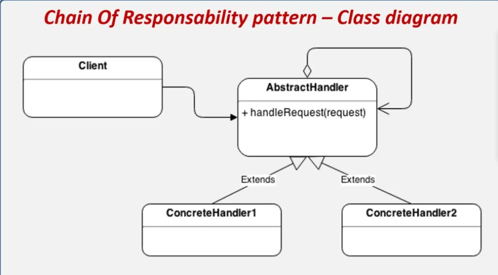

# ANTES Y DESPUES: CASO DE USO CU07 - GESTIONAR ASISTENCIA (PATRON CHAIN OF RESPONSIBILITY)

## 1. Contexto del Caso de Uso `CU07 - GESTIONAR ASISTENCIA`
El Caso de Uso **CU07 - Gestionar Asistencia** reside en el microservicio `asistencia-service` (puerto `8082`). Su operacion critica es el registro de asistencia del estudiante mediante el Codigo QR generado para una sesion de clase activa (`POST /api/v1/asistencia/registros/marcar-qr` -> `AsistenciaServiceImpl.registrarAsistenciaQr`).

---

## 2. Diagrama de Referencia Obligatoria Aplicado


---

## 3. Analisis del ANTES (Implementacion Original Monolitica)

### 3.1. Problemas Arquitectonicos Detectados
En la version original de `AsistenciaServiceImpl.java`:
1. **Violacion del Principio de Responsabilidad Unica (SRP):** Un solo metodo (`registrarAsistenciaQr`) concentraba 5 reglas de validacion distintas (existencia/estado de sesion, vigencia temporal del QR, control de duplicidad en base de datos, invocacion HTTP remota por OpenFeign a `academico-service` y calculo aritmetico de puntualidad), ademas de la persistencia y el mapeo a DTO.
2. **Violacion del Principio Abierto/Cerrado (OCP):** Si se requeria incorporar una nueva validacion (por ejemplo, verificar horario del dia, geocerca del aula o bloqueo por dispositivo), era obligatorio modificar directamente el cuerpo de `AsistenciaServiceImpl`.
3. **Baja Testabilidad Aislada:** No era posible probar unitariamente la regla de expiracion del QR o el calculo de atraso sin instanciar todo el servicio y simular todas las dependencias previas.
4. **Tolerancia Codificada en Duro (*Magic Number*):** El limite de 15 minutos (`minutosTranscurridos <= 15`) estaba fijo dentro del metodo sin posibilidad de configuracion externa.

### 3.2. Codigo Original (ANTES)
```java
// ANTES: Metodo monolitico en AsistenciaServiceImpl.java
@Override
@Transactional
public AsistenciaResponseDto registrarAsistenciaQr(MarcarAsistenciaQrDto dto) {
    // 1. Validar existencia y estado de la sesion por su codigo QR
    SesionClase sesion = sesionRepository.findByCodigoQrGenerado(dto.getCodigoQr())
            .orElseThrow(() -> new IllegalArgumentException("El codigo QR escaneado no corresponde a ninguna sesion valida"));

    if (sesion.getEstado() != EstadoSesion.ACTIVA) {
        throw new IllegalStateException("La sesion de clase se encuentra " + sesion.getEstado() + ". No es posible registrar asistencia");
    }

    // 2. Validar vigencia temporal del QR
    if (sesion.getExpiracionQr() != null && LocalDateTime.now().isAfter(sesion.getExpiracionQr())) {
        throw new IllegalStateException("El codigo QR ha expirado. Solicite al docente que regenere el codigo");
    }

    // 3. Validar duplicidad
    if (asistenciaRepository.existsBySesionClaseIdAndRegistroEstudiante(sesion.getId(), dto.getRegistroEstudiante())) {
        throw new IllegalStateException("El estudiante con registro " + dto.getRegistroEstudiante() + " ya tiene registrada su asistencia en esta sesion");
    }

    // 4. Invocacion a microservicio academico mediante OpenFeign
    VerificacionInscripcionResponse verificacion = academicoClient.verificarInscripcion(
            dto.getRegistroEstudiante(), sesion.getIdGrupoReferencia());
    if (verificacion == null || !verificacion.isInscrito()) {
        throw new IllegalArgumentException("No se puede registrar asistencia: Inscripcion no valida");
    }

    // 5. Determinar estado de asistencia (tolerancia fija de 15 minutos en duro)
    LocalTime ahora = LocalTime.now();
    long minutosTranscurridos = Duration.between(sesion.getHoraInicio(), ahora).toMinutes();
    EstadoAsistencia estadoAsistencia = (minutosTranscurridos <= 15)
            ? EstadoAsistencia.PRESENTE
            : EstadoAsistencia.ATRASO;

    // 6. Persistir y retornar...
}
```

---

## 4. Analisis del DESPUES (Con el Patron Chain of Responsibility)

### 4.1. Estructura Implementada
Siguiendo estrictamente el diagrama de clases de referencia:
* **`Client` (`AsistenciaServiceImpl`)**: Construye el objeto `AsistenciaValidationContext` (`request`) y lo entrega al manejador raiz mediante `this.abstractHandler.handleRequest(requestContext)`.
* **`AbstractHandler` (`AbstractAsistenciaHandler`)**: Clase abstracta con auto-agregacion `# siguiente: AbstractAsistenciaHandler`, metodo `+ setSiguiente(AbstractAsistenciaHandler): AbstractAsistenciaHandler`, metodo abstracto `+ handleRequest(AsistenciaValidationContext request): void` y metodo protegido `# pasarAlSiguiente(AsistenciaValidationContext request): void`.
* **`ConcreteHandlers` (Heredan con `extends AbstractAsistenciaHandler`)**:
  1. `SesionActivaHandler`: Busca la sesion por QR, valida `EstadoSesion.ACTIVA`, guarda la sesion en `request.setSesionClase(sesion)` y llama a `pasarAlSiguiente(request)`.
  2. `VigenciaQrHandler`: Verifica que `LocalDateTime.now()` no sea posterior a `sesion.getExpiracionQr()` y llama a `pasarAlSiguiente(request)`.
  3. `DuplicidadAsistenciaHandler`: Verifica que `existsBySesionClaseIdAndRegistroEstudiante` sea `false` y llama a `pasarAlSiguiente(request)`.
  4. `InscripcionAcademicaHandler`: Consulta `AcademicoFeignClient.verificarInscripcion`, valida `verificacion.isInscrito()`, guarda la respuesta en `request.setVerificacionInscripcion(verificacion)` y llama a `pasarAlSiguiente(request)`.
  5. `CalculoPuntualidadHandler`: Calcula la diferencia entre `sesion.getHoraInicio()` y `request.getHoraEvaluacion()` usando `@Value("${asistencia.tolerancia-minutos:15}")` y asigna `PRESENTE` o `ATRASO` en `request.setEstadoAsistenciaCalculado(...)`.

### 4.2. Codigo Refactorizado (DESPUES)
```java
// DESPUES: AsistenciaServiceImpl.java actuando como Client de AbstractAsistenciaHandler
@Override
@Transactional
public AsistenciaResponseDto registrarAsistenciaQr(MarcarAsistenciaQrDto dto) {
    // 1. Construir el objeto Request (AsistenciaValidationContext)
    AsistenciaValidationContext requestContext = AsistenciaValidationContext.builder()
            .registroEstudiante(dto.getRegistroEstudiante())
            .codigoQr(dto.getCodigoQr())
            .observacion(dto.getObservacion())
            .fechaEvaluacion(LocalDate.now())
            .horaEvaluacion(LocalTime.now())
            .build();

    // 2. Delegar todas las validaciones a la cadena de responsabilidad
    this.abstractHandler.handleRequest(requestContext);

    // 3. Persistir entidad con los datos validados por la cadena
    SesionClase sesion = requestContext.getSesionClase();
    VerificacionInscripcionResponse verificacion = requestContext.getVerificacionInscripcion();
    EstadoAsistencia estadoAsistencia = requestContext.getEstadoAsistenciaCalculado();

    Asistencia asistencia = Asistencia.builder()
            .fechaRegistro(requestContext.getFechaEvaluacion())
            .horaRegistro(requestContext.getHoraEvaluacion())
            .metodoValidacion(MetodoValidacion.QR)
            .registroEstudiante(dto.getRegistroEstudiante())
            .nombreEstudiante(verificacion.getNombreEstudiante())
            .sesionClase(sesion)
            .estadoAsistencia(estadoAsistencia)
            .observacion(dto.getObservacion() != null ? dto.getObservacion() : "Registro exitoso via escaneo QR")
            .build();

    Asistencia guardada = asistenciaRepository.save(asistencia);
    return mapearADtoConContextoAcademico(guardada, sesion, verificacion);
}
```

---

## 5. Comparativa Arquitectonica (Antes vs. Despues en `CU07`)

| Criterio de Evaluacion | Antes (Sin Patron) | Despues (Con Chain of Responsibility) |
| :--- | :--- | :--- |
| **Cohesion de Clase** | Baja: `AsistenciaServiceImpl` mezclaba 5 validaciones heterogeneas y persistencia. | Alta: Cada `ConcreteHandler` valida una unica regla de negocio. |
| **Acoplamiento** | Alto: El servicio principal dependia directamente del detalle de todas las validaciones. | Bajo: `AsistenciaServiceImpl` solo conoce a `AbstractAsistenciaHandler` y `handleRequest(request)`. |
| **Cumplimiento de OCP** | Nulo: Agregar una sexta validacion obligaba a editar `registrarAsistenciaQr`. | Total: Se crea un nuevo `ConcreteHandler extends AbstractAsistenciaHandler` y se enlaza con `setSiguiente`. |
| **Pruebas Unitarias** | Complejas: Requeria configurar todos los mocks para probar una sola regla. | Simples y aisladas: Cada eslabon se prueba de forma independiente (`AsistenciaValidationChainTest`). |

