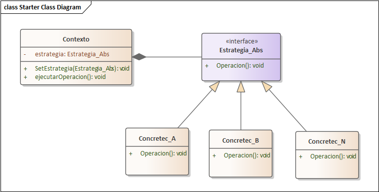

# ANTES Y DESPUES: CASO DE USO CU03 - GESTIONAR ESTUDIANTE (PATRON STRATEGY)

## 1. Contexto del Caso de Uso `CU03 - GESTIONAR ESTUDIANTE`
El Caso de Uso **CU03 - Gestionar Estudiante** se implementa en `academico-service` (puerto `8081`). Ademas de las operaciones CRUD individuales en `EstudianteServiceImpl`, incluye el proceso de **importacion masiva de estudiantes** hacia un grupo academico (`POST /api/v1/academico/grupos/{id}/importar-estudiantes` -> `ImportacionEstudiantesServiceImpl`), el cual admite archivos en formato **Excel (`.xlsx` / `.xls`)**, **PDF (`.pdf`)** y **CSV (`.csv`)**.

---

## 2. Diagrama de Referencia Obligatoria Aplicado


---

## 3. Analisis del ANTES (Implementacion Original con Bifurcacion `if / else`)

### 3.1. Problemas Arquitectonicos Detectados
En la version original de `ImportacionEstudiantesServiceImpl.java` (632 lineas):
1. **Bifurcacion Condicional Rigida (`if / else if / else`):** La seleccion del algoritmo de parseo se realizaba evaluando manualmente las extensiones del archivo dentro del metodo de negocio principal (`importarEstudiantesAGrupo`).
2. **Violacion del Principio de Responsabilidad Unica (SRP):** La clase de servicio no solo coordinaba la inscripcion de estudiantes, las bajas logicas de boletas y el aprovisionamiento en `auth-service` via OpenFeign, sino que tambien contenia mas de 200 lineas de metodos privados de bajo nivel para manipular celdas de Apache POI (`parsearExcel`), flujos de texto de Apache PDFBox (`parsearPdf`) y cadenas delimitadas (`parsearCsv`, `desescaparLineaCsvSiEsNecesario`, `dividirLineaCsv`).
3. **Violacion del Principio Abierto/Cerrado (OCP):** Incorporar un nuevo formato de importacion (por ejemplo, JSON o XML) obligaba a modificar directamente `ImportacionEstudiantesServiceImpl`, agregando otro bloque `else if` y nuevos metodos privados.

### 3.2. Codigo Original (ANTES)
```java
// ANTES: Bifurcacion condicional en ImportacionEstudiantesServiceImpl.java (Lineas 100-111)
try {
    if (nombreArchivo.endsWith(".xlsx") || nombreArchivo.endsWith(".xls")) {
        filas = parsearExcel(archivo.getInputStream());
    } else if (nombreArchivo.endsWith(".pdf")) {
        filas = parsearPdf(archivo.getInputStream());
    } else {
        filas = parsearCsv(archivo.getInputStream());
    }
} catch (Exception e) {
    log.error("Error al parsear archivo de estudiantes", e);
    throw new IllegalArgumentException("Error al procesar el archivo: " + e.getMessage());
}
// Seguido de mas de 200 lineas de metodos privados: parsearPdf(), parsearCsv(), parsearExcel()...
```

---

## 4. Analisis del DESPUES (Con el Patron Strategy)

### 4.1. Estructura Implementada
Siguiendo estrictamente el diagrama de clases de referencia en Enterprise Architect:
* **`Contexto` (`ContextoParserArchivo`)**:
  * Posee el atributo privado `- estrategia: EstrategiaParserArchivo` (relacion de composicion hacia la interfaz de estrategia).
  * Expone el metodo `+ setEstrategia(EstrategiaParserArchivo estrategia): void` para asignar dinamicamente la estrategia en tiempo de ejecucion.
  * Expone el metodo `+ ejecutarOperacion(InputStream inputStream): List<Map<String, String>>` que delega la lectura a `this.estrategia.operacion(inputStream)`.
  * Incluye el metodo `+ seleccionarEstrategiaPorArchivo(String nombreArchivo): void` que localiza polimorficamente la estrategia compatible y llama a `this.setEstrategia(seleccionada)`.
* **`<<interface>> Estrategia_Abs` (`EstrategiaParserArchivo`)**:
  * Declara la firma polimorfica `+ operacion(InputStream inputStream): List<Map<String, String>>` y `+ soportaArchivo(String nombreArchivo): boolean`.
* **`ConcreteStrategies` (Implementan `EstrategiaParserArchivo`)**:
  1. `ExcelParserConcreteStrategy` (`Concretec_A`): Implementa `+ operacion(InputStream)` encapsulando la lectura de hojas `.xlsx` y `.xls` con Apache POI.
  2. `PdfParserConcreteStrategy` (`Concretec_B`): Implementa `+ operacion(InputStream)` encapsulando la extraccion tabular desde documentos `.pdf` con Apache PDFBox.
  3. `CsvParserConcreteStrategy` (`Concretec_N`): Implementa `+ operacion(InputStream)` encapsulando el procesamiento de archivos `.csv` con soporte de BOM UTF-8, delimitadores multiples y comillas escapadas.

### 4.2. Codigo Refactorizado (DESPUES)
```java
// DESPUES: ImportacionEstudiantesServiceImpl.java delegando en ContextoParserArchivo
try {
    contextoParser.seleccionarEstrategiaPorArchivo(nombreArchivo);
    filas = contextoParser.ejecutarOperacion(archivo.getInputStream());
} catch (Exception e) {
    log.error("Error al parsear archivo de estudiantes mediante ContextoParserArchivo", e);
    throw new IllegalArgumentException("Error al procesar el archivo: " + e.getMessage());
}
```

---

## 5. Comparativa Arquitectonica (Antes vs. Despues en `CU03`)

| Criterio de Evaluacion | Antes (Sin Patron) | Despues (Con Strategy) |
| :--- | :--- | :--- |
| **Tamano y Complejidad** | 632 lineas en una sola clase monolitica. | Servicio enfocado en logica de negocio; cada parser vive en su propia clase `@Component`. |
| **Estructuras Condicionales** | `if (xlsx) ... else if (pdf) ... else csv` acoplado. | Polimorfismo puro a traves de `ContextoParserArchivo` y `EstrategiaParserArchivo.operacion()`. |
| **Cumplimiento de OCP** | Nulo: Soportar otro formato requeria modificar `ImportacionEstudiantesServiceImpl`. | Total: Basta con crear una nueva clase que implemente `EstrategiaParserArchivo`. |
| **Pruebas Unitarias** | Los metodos de parseo eran `private` y no podian probarse directamente. | Cada estrategia concreta se prueba de forma directa e independiente (`ContextoParserArchivoStrategyTest`). |

