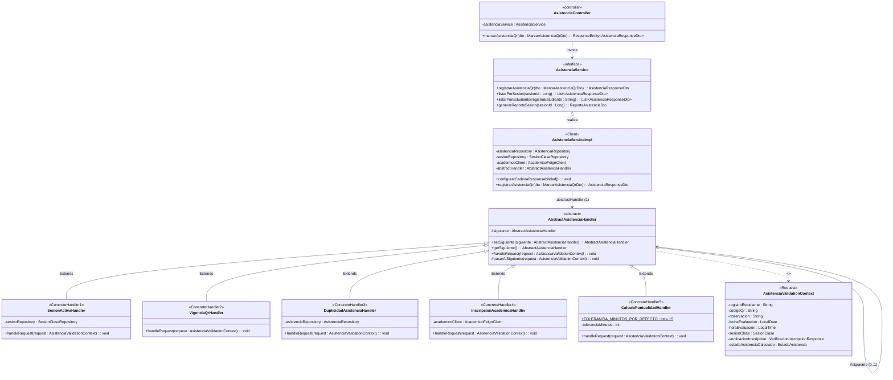
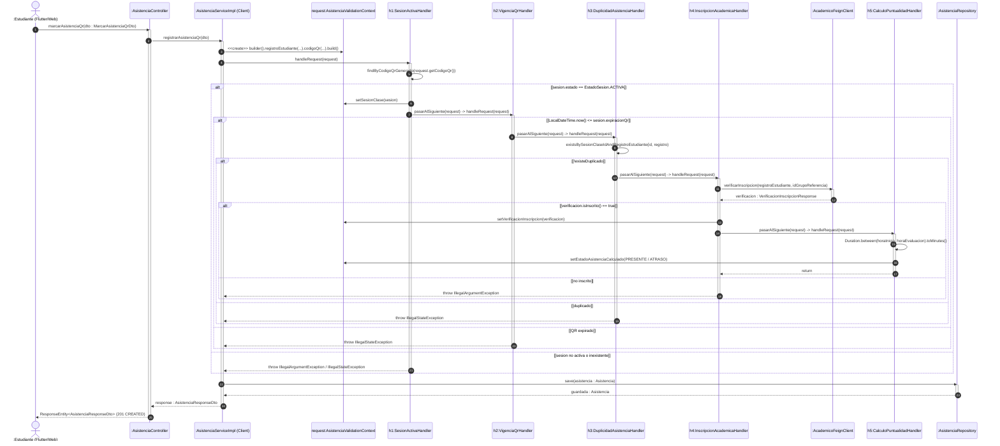
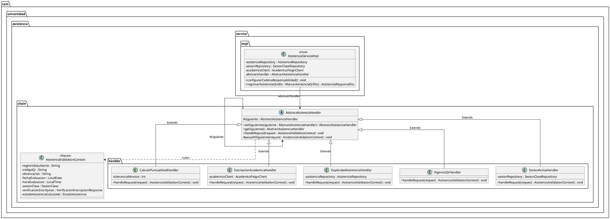
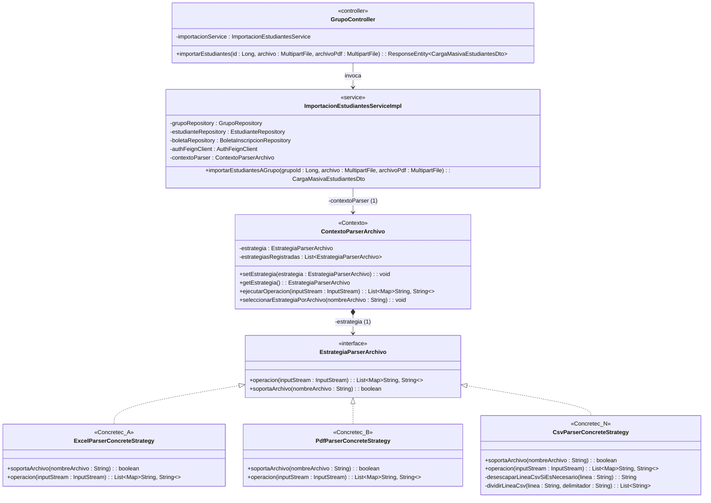
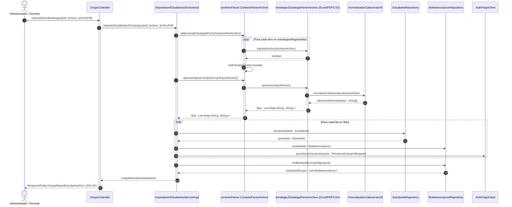
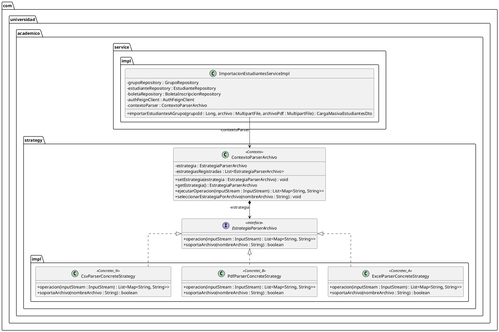

# DOCUMENTACION DE DISENO PROCEDIMENTAL Y DIAGRAMAS DE CLASES DINAMICOS (ESTANDAR OMG UML 2.5+)

Este documento especifica los **Diagramas de Diseno Procedimental (Diagramas de Clases Dinamicos, Diagramas de Secuencia de Diseno y Diagramas de Comunicacion)** bajo el estandar **OMG UML 2.5+** para los dos patrones de diseno implementados en el proyecto:
1. **Patron 1: Chain of Responsibility** en `CU07 - GESTIONAR ASISTENCIA` (`asistencia-service`).
2. **Patron 2: Strategy** en `CU03 - GESTIONAR ESTUDIANTE` (`academico-service`).

---

## 1. CU07 - GESTIONAR ASISTENCIA: Patron Chain of Responsibility (UML 2.5+)

### 1.1. Diagrama de Clases Dinamico / Estructural de Diseno (UML 2.5+)

### 1.2. Diagrama de Diseno Procedimental (Interaccion Dinamica de Objetos en Tiempo de Ejecucion - `CU07`)

### 1.3. Especificacion PlantUML (`.puml`) — `CU07 Chain of Responsibility`

---

## 2. CU03 - GESTIONAR ESTUDIANTE: Patron Strategy (UML 2.5+)

### 2.1. Diagrama de Clases Dinamico / Estructural de Diseno (UML 2.5+)

### 2.2. Diagrama de Diseno Procedimental (Interaccion Dinamica de Objetos en Tiempo de Ejecucion - `CU03`)

### 2.3. Especificacion PlantUML (`.puml`) — `CU03 Strategy`

