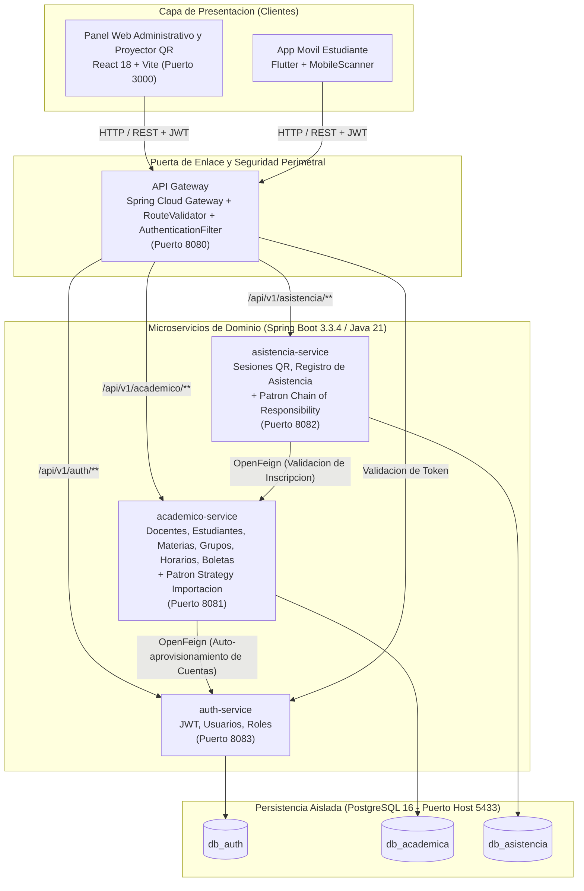
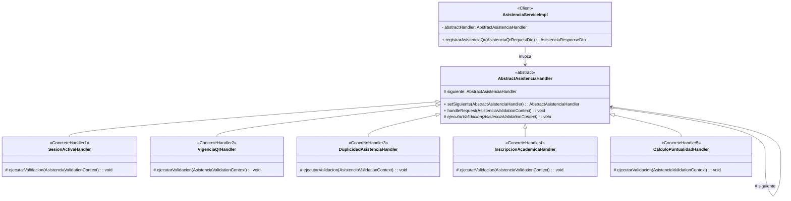
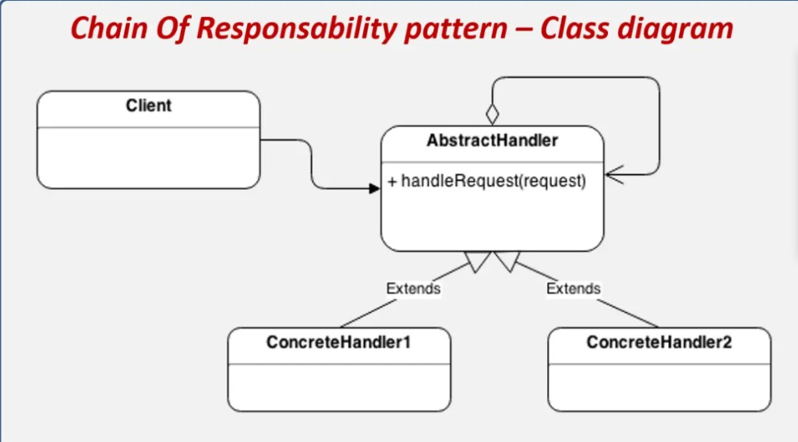
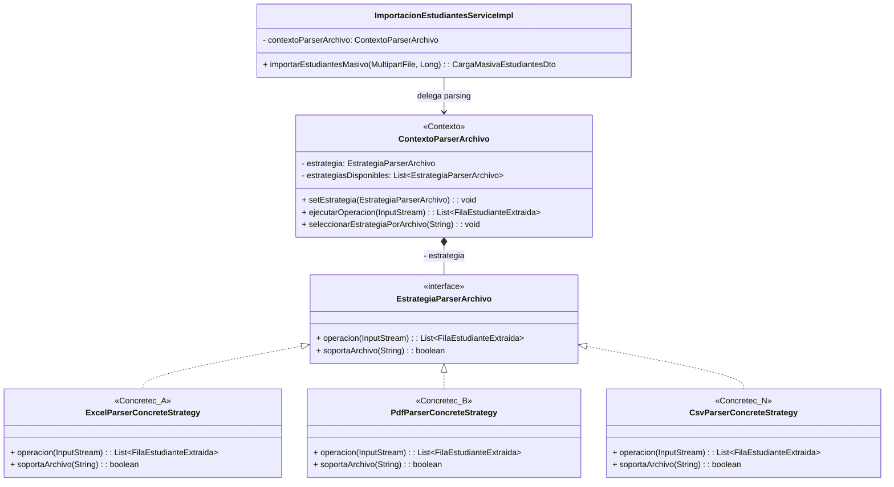
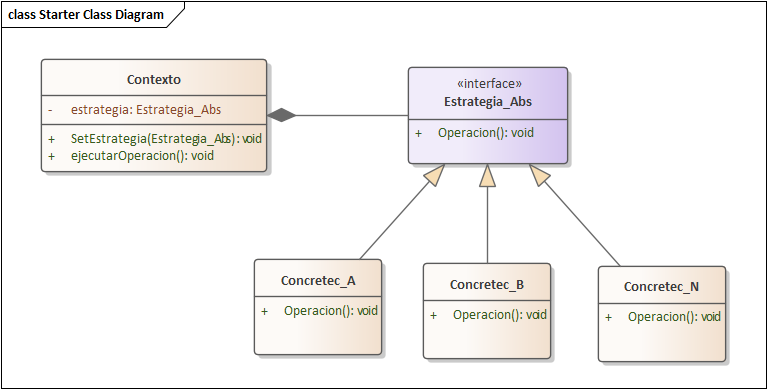
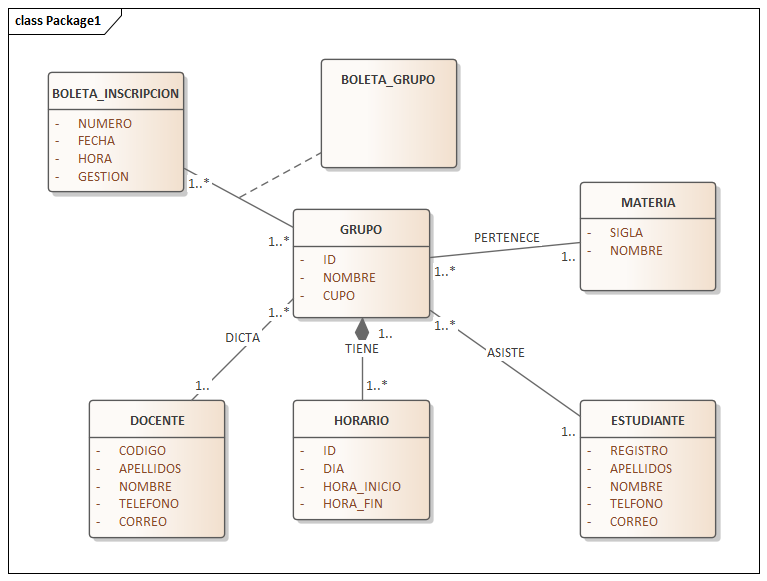
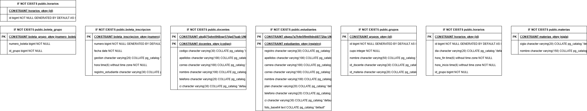

<div align="center">

# Sistema Universitario de Control de Asistencia QR en Microservicios

**Arquitectura distribuida orientada a servicios (Spring Boot 3 + Spring Cloud + React + Flutter + PostgreSQL)**  
*Aplicacion de Patrones de Diseno GoF (Chain of Responsibility y Strategy), Clean Architecture y Modelado UML 2.5+ (Enterprise Architect 15)*

<p>
  
  
  
  
  
  
  
  
</p>

<p>
  <a href="#arquitectura-general-del-sistema">Arquitectura</a> |
  <a href="#patrones-de-diseno-implementados">Patrones GoF</a> |
  <a href="#correcciones-criticas-y-deuda-tecnica">Deuda Tecnica</a> |
  <a href="#catalogo-de-casos-de-uso">Casos de Uso</a> |
  <a href="#documentacion-y-modelos-uml-25">Modelos UML / .EAP</a> |
  <a href="#guia-de-inicio-rapido">Despliegue</a> |
  <a href="#pruebas-automatizadas">Pruebas</a>
</p>

</div>

---

## Descripcion del Proyecto

Plataforma universitaria integral para el registro, validacion y auditoria de asistencia academica mediante codigos QR dinamicos. El sistema separa las responsabilidades en tres microservicios de dominio con bases de datos aisladas (**Database per Service**), enrutados por un **API Gateway** reactivo con validacion centralizada de JWT, comunicacion sincronica mediante **OpenFeign**, panel administrativo web en **React + Vite** (con proyector QR y carga masiva multiformato) y aplicacion movil en **Flutter** para el escaneo estudiantil.

---

## Arquitectura General del Sistema



### Mapa de Servicios, Puertos y Persistencia

| Componente | Tecnologia | Puerto Host | Base de Datos | Responsabilidad Principal |
| :--- | :--- | :--- | :--- | :--- |
| **api-gateway** | Spring Cloud Gateway | `8080` | - | Enrutamiento centralizado, CORS y filtro `AuthenticationFilter` JWT |
| **academico-service** | Spring Boot + JPA + POI + PDFBox | `8081` | `db_academica` | Docentes, estudiantes, materias, grupos, horarios, boletas e importacion masiva |
| **asistencia-service** | Spring Boot + JPA + OpenFeign | `8082` | `db_asistencia` | Apertura/cierre de sesiones QR, cadena de validacion y registro de asistencia |
| **auth-service** | Spring Boot + JPA + JJWT 0.12.6 | `8083` | `db_auth` | Autenticacion, gestion de usuarios, roles y emision/validacion de JWT |
| **frontend-admin** | React 18 + Vite + Axios | `3000` | - | Dashboard, CRUD academico, importador masivo y proyector QR |
| **mobile-app** | Flutter + Dart 3 | Dispositivo | Local + REST | Escaneo QR estudiantil, historial y consulta de materias |
| **postgres-db** | PostgreSQL 16 Alpine (Docker) | `5433` (`5432` interno) | 3 BDs aisladas | Almacenamiento relacional independiente por microservicio |
| **pgadmin** | pgAdmin 4 (Docker) | `5050` | - | Administracion web de las bases de datos PostgreSQL |

---

## Patrones de Diseno Implementados

Como parte de la refactorizacion arquitectonica del Segundo Parcial, se implementaron **dos patrones de diseno GoF** respetando estrictamente Clean Architecture, principios SOLID, inyeccion de dependencias por constructor y las plantillas estructurales UML 2.5+ de referencia.

### 1. Chain of Responsibility — `CU07: GESTIONAR ASISTENCIA` (`asistencia-service`)

Desacopla y modulariza las validaciones secuenciales del registro de asistencia por codigo QR (`registrarAsistenciaQr`), eliminando la logica monolitica previa en [`AsistenciaServiceImpl`](backend/asistencia-service/src/main/java/com/universidad/asistencia/service/impl/AsistenciaServiceImpl.java).



<p align="center">
  
</p>

| Orden | Eslabon (`ConcreteHandler`) | Archivo | Responsabilidad |
| :--- | :--- | :--- | :--- |
| 1 | `SesionActivaHandler` | [`SesionActivaHandler.java`](backend/asistencia-service/src/main/java/com/universidad/asistencia/chain/handler/SesionActivaHandler.java) | Verifica que la sesion exista y su estado sea `ABIERTA`. |
| 2 | `VigenciaQrHandler` | [`VigenciaQrHandler.java`](backend/asistencia-service/src/main/java/com/universidad/asistencia/chain/handler/VigenciaQrHandler.java) | Valida la coincidencia del token QR (`totpSecret`) y su ventana `qrExpiracion`. |
| 3 | `DuplicidadAsistenciaHandler` | [`DuplicidadAsistenciaHandler.java`](backend/asistencia-service/src/main/java/com/universidad/asistencia/chain/handler/DuplicidadAsistenciaHandler.java) | Impide registros duplicados para el mismo estudiante en una misma sesion. |
| 4 | `InscripcionAcademicaHandler` | [`InscripcionAcademicaHandler.java`](backend/asistencia-service/src/main/java/com/universidad/asistencia/chain/handler/InscripcionAcademicaHandler.java) | Consulta `academico-service` via OpenFeign para validar inscripcion en el grupo. |
| 5 | `CalculoPuntualidadHandler` | [`CalculoPuntualidadHandler.java`](backend/asistencia-service/src/main/java/com/universidad/asistencia/chain/handler/CalculoPuntualidadHandler.java) | Calcula minutos de tolerancia y asigna `PRESENTE` (<= 15 min) o `ATRASO` (> 15 min). |

> Referencia de analisis Antes/Despues: [`02-ANTES_Y_DESPUES_CU07_CHAIN_OF_RESPONSIBILITY.md`](documentos-parcial2/02-ANTES_Y_DESPUES_CU07_CHAIN_OF_RESPONSIBILITY.md)

---

### 2. Strategy — `CU03: GESTIONAR ESTUDIANTE` (`academico-service`)

Elimina la bifurcacion condicional `if / else if / else` por extension de archivo en [`ImportacionEstudiantesServiceImpl`](backend/academico-service/src/main/java/com/universidad/academico/service/impl/ImportacionEstudiantesServiceImpl.java), encapsulando cada algoritmo de extraccion de listas universitarias bajo un contrato polimorfico intercambiable en tiempo de ejecucion.



<p align="center">
  
</p>

| Estrategia Concreta | Rol en Plantilla | Formatos | Tecnologia / Funcion |
| :--- | :--- | :--- | :--- |
| [`ExcelParserConcreteStrategy`](backend/academico-service/src/main/java/com/universidad/academico/strategy/impl/ExcelParserConcreteStrategy.java) | `Concretec_A` | `.xlsx`, `.xls` | Extraccion tabular mediante Apache POI y [`NormalizadorCabecerasUtil`](backend/academico-service/src/main/java/com/universidad/academico/strategy/util/NormalizadorCabecerasUtil.java). |
| [`PdfParserConcreteStrategy`](backend/academico-service/src/main/java/com/universidad/academico/strategy/impl/PdfParserConcreteStrategy.java) | `Concretec_B` | `.pdf` | Extraccion textual de planillas UAGRM mediante Apache PDFBox y expresiones regulares. |
| [`CsvParserConcreteStrategy`](backend/academico-service/src/main/java/com/universidad/academico/strategy/impl/CsvParserConcreteStrategy.java) | `Concretec_N` | `.csv` | Lectura de texto delimitado con autodeteccion de separador (`,`, `;`, `\t`) y limpieza de comillas/BOM. |

> Referencia de analisis Antes/Despues: [`03-ANTES_Y_DESPUES_CU03_STRATEGY.md`](documentos-parcial2/03-ANTES_Y_DESPUES_CU03_STRATEGY.md)

<details>
<summary>Ver Modelo Conceptual Inicial del Dominio y Esquema Fisico Academico</summary>

<p align="center">
  <strong>Modelo de Clases de Dominio Inicial (Enterprise Architect)</strong><br/>
  
</p>

<p align="center">
  <strong>Esquema Fisico Relacional (db_academica)</strong><br/>
  
</p>

</details>

---

## Correcciones Criticas y Deuda Tecnica

| Codigo | Microservicio | Hallazgo Resuelto | Archivo Modificado |
| :--- | :--- | :--- | :--- |
| **DT-01** | `api-gateway` | Correccion de llaves mal escritas (`routes:`, `name: AuthenticationFilter`) en rutas de grupos, inscripciones y sesiones. | [`application.yml`](backend/api-gateway/src/main/resources/application.yml) |
| **DT-02** | `api-gateway` | Reemplazo de `.contains(uri)` por `.startsWith(uri)` en `RouteValidator` para impedir omision de rutas protegidas. | [`RouteValidator.java`](backend/api-gateway/src/main/java/com/universidad/gateway/filter/RouteValidator.java) |
| **DT-03** | `asistencia-service` | Eliminacion de `findAll()` en memoria para listar sesiones abiertas usando consultas JPQL ordenadas. | [`SesionClaseRepository.java`](backend/asistencia-service/src/main/java/com/universidad/asistencia/repository/SesionClaseRepository.java) |
| **DT-04** | `asistencia-service` | Filtro de sesiones por docente/grupos directo en base de datos y proteccion contra listas `IN ()` vacias. | [`SesionClaseServiceImpl.java`](backend/asistencia-service/src/main/java/com/universidad/asistencia/service/impl/SesionClaseServiceImpl.java) |
| **DT-05** | `academico-service` | Validacion obligatoria de inscripcion duplicada y verificacion de `cupo` disponible en `BoletaInscripcionServiceImpl`. | [`BoletaInscripcionServiceImpl.java`](backend/academico-service/src/main/java/com/universidad/academico/service/impl/BoletaInscripcionServiceImpl.java) |
| **DT-06** | `auth`, `academico`, `asistencia` | Unificacion de `ErrorResponseDto` exponiendo `getMessage()` junto a `mensaje` para interoperabilidad Web/Movil. | [`ErrorResponseDto.java`](backend/academico-service/src/main/java/com/universidad/academico/dto/ErrorResponseDto.java) |
| **DT-07** | `auth-service` | Validacion explicita de expiracion y firma JWT en `validarToken(String token)`. | [`AuthServiceImpl.java`](backend/auth-service/src/main/java/com/universidad/auth/service/impl/AuthServiceImpl.java) |

---

## Catalogo de Casos de Uso

| ID | Caso de Uso | Microservicio Responsable | Estado y Patron Asociado |
| :--- | :--- | :--- | :--- |
| **CU01** | Gestionar Usuario-Roles | `auth-service` | Autenticacion JWT, RBAC (`ADMINISTRADOR`, `DOCENTE`, `ESTUDIANTE`) + DT-07. |
| **CU02** | Gestionar Docente | `academico-service` | CRUD completo y vinculacion con cuentas en `auth-service`. |
| **CU03** | Gestionar Estudiante | `academico-service` | CRUD, portal estudiantil y carga masiva refactorizada con **Patron Strategy**. |
| **CU04** | Gestionar Materia | `academico-service` | Administracion de catalogo de materias universitarias y siglas. |
| **CU05** | Gestionar Grupo | `academico-service` | Configuracion de grupos academicos, cupos, gestion y horarios (`HorarioController`). |
| **CU06** | Gestionar Boleta de Inscripcion | `academico-service` | Inscripcion de estudiantes a grupos con control de duplicidad y cupos (DT-05). |
| **CU07** | Gestionar Asistencia | `asistencia-service` | Sesiones QR dinamicas y validacion refactorizada con **Patron Chain of Responsibility**. |

---

## Documentacion y Modelos UML 2.5+

Toda la documentacion tecnica, diagramas de clases dinamicos (diseno procedimental UML 2.5+) y el proyecto nativo de **Sparx Systems Enterprise Architect 15** se encuentran organizados en [`documentos-parcial2/`](documentos-parcial2/) y [`DATOS DE PRUEBAS Y FORMATO/`](DATOS%20DE%20PRUEBAS%20Y%20FORMATO/):

| Artefacto | Contenido | Ubicacion |
| :--- | :--- | :--- |
| **Plan de Implementacion** | Analisis completo de los 7 CU por complejidad, patrones seleccionados y correcciones. | [`01-PLAN_IMPLEMENTACION_PATRONES_DISEÑO.md`](documentos-parcial2/01-PLAN_IMPLEMENTACION_PATRONES_DISE%C3%91O.md) |
| **Antes y Despues CU07** | Evolucion de `AsistenciaServiceImpl` hacia Chain of Responsibility. | [`02-ANTES_Y_DESPUES_CU07_CHAIN_OF_RESPONSIBILITY.md`](documentos-parcial2/02-ANTES_Y_DESPUES_CU07_CHAIN_OF_RESPONSIBILITY.md) |
| **Antes y Despues CU03** | Evolucion de `ImportacionEstudiantesServiceImpl` hacia Strategy. | [`03-ANTES_Y_DESPUES_CU03_STRATEGY.md`](documentos-parcial2/03-ANTES_Y_DESPUES_CU03_STRATEGY.md) |
| **Diagramas UML 2.5+ Dinamicos** | Diagramas estructurales, secuencia y comunicacion con numeracion jerarquica (`1`, `1.1`, `2.1.1`). | [`04-DIAGRAMAS_DISENO_PROCEDIMENTAL_CLASES_DINAMICOS_UML25.md`](documentos-parcial2/04-DIAGRAMAS_DISENO_PROCEDIMENTAL_CLASES_DINAMICOS_UML25.md) |
| **Proyecto EA 15 (.eap)** | Repositorio Jet 4.0 nativo listo para abrir en Enterprise Architect 15. | [`arquitectura_patrones_uml25_ea15.eap`](documentos-parcial2/arquitectura_patrones_uml25_ea15.eap) |
| **Intercambio XMI 2.5.1** | Paquete XML estandar UML 2.5.1 importable mediante `Ctrl+Alt+I` en EA 15. | [`arquitectura_patrones_uml25_ea15_xmi.xml`](documentos-parcial2/arquitectura_patrones_uml25_ea15_xmi.xml) |

---

## Guia de Inicio Rapido

### Requisitos Previos
* **Java JDK 21** y Maven (el repositorio incluye Maven wrapper/distribucion local en `backend/maven/`).
* **Docker y Docker Compose** para PostgreSQL 16 y pgAdmin 4.
* **Node.js 18+** para el panel administrativo React.
* **Flutter SDK 3.x** para compilar o ejecutar la aplicacion movil.

### 1. Levantar Bases de Datos (Docker)
```bash
docker-compose up -d
```
El script [`init-db/01-init.sql`](init-db/01-init.sql) crea automaticamente `db_auth`, `db_academica` y `db_asistencia` en PostgreSQL expuesto en el puerto `5433`.

### 2. Iniciar Microservicios Backend
En cuatro terminales independientes (respetando el orden de disponibilidad):

```bash
# Terminal 1: auth-service (Puerto 8083)
cd backend/auth-service && ../maven/bin/mvn spring-boot:run

# Terminal 2: academico-service (Puerto 8081)
cd backend/academico-service && ../maven/bin/mvn spring-boot:run

# Terminal 3: asistencia-service (Puerto 8082)
cd backend/asistencia-service && ../maven/bin/mvn spring-boot:run

# Terminal 4: api-gateway (Puerto 8080)
cd backend/api-gateway && ../maven/bin/mvn spring-boot:run
```

### 3. Iniciar Frontend Web Administrativo (`frontend-admin`)
```bash
cd frontend-admin
npm install
npm run dev
```
Disponible en `http://localhost:3000`.

### 4. Iniciar Aplicacion Movil (`mobile-app`)
```bash
cd mobile-app
flutter pub get
flutter run
```

### Credenciales Iniciales de Prueba (Seeders)

| Rol | Usuario / Registro | Contrasena |
| :--- | :--- | :--- |
| **ADMINISTRADOR** | `admin` | `admin123` |
| **DOCENTE** | `DOC-101` | `docente123` |
| **ESTUDIANTE 1** | `2024001` | `estudiante123` |
| **ESTUDIANTE 2** | `2024002` | `estudiante123` |

---

## Pruebas Automatizadas

Para compilar y ejecutar todas las suites de pruebas unitarias del ecosistema backend (incluyendo las suites de los patrones **Chain of Responsibility**, **Strategy** y **BoletaInscripcionServiceTest**):

```bash
# Windows PowerShell
cd backend
.\maven\bin\mvn.cmd test

# Linux / macOS
cd backend
./maven/bin/mvn test
```

Resultado observado en el reactor Maven (18 pruebas en total, 0 fallos, 0 errores, 0 omitidas):
* `api-gateway`: Compilacion limpia.
* `auth-service`: 3 tests ejecutados (`AuthServiceTest`), 0 fallos.
* `academico-service`: 9 tests ejecutados (`BoletaInscripcionServiceTest`: 3, `PdfExtractorTest`: 1, `ContextoParserArchivoStrategyTest`: 5), 0 fallos.
* `asistencia-service`: 6 tests ejecutados (`AsistenciaValidationChainTest`: 4, `AsistenciaServiceTest`: 2), 0 fallos.

---

## Estructura del Repositorio

```text
CONTROL_ASISTENCIA_MICROSERVICIOS/
|-- backend/
|   |-- api-gateway/                  # Enrutamiento Reactivo, RouteValidator y AuthenticationFilter (8080)
|   |-- auth-service/                 # Autenticacion JWT, Usuarios y Roles (8083)
|   |-- academico-service/            # Gestion Academica + Patron Strategy Importacion (8081)
|   |-- asistencia-service/           # Sesiones QR + Patron Chain of Responsibility (8082)
|   |-- maven/                        # Distribucion local de Apache Maven
|   `-- pom.xml                       # POM padre multi-modulo (Java 21, Spring Boot 3.3.4)
|-- frontend-admin/                   # Panel Web React 18 + Vite (3000)
|-- mobile-app/                       # Aplicacion Movil Flutter con escaneo QR
|-- init-db/                          # Script SQL de inicializacion (db_auth, db_academica, db_asistencia)
|-- documentos-parcial2/              # Documentacion del 2do parcial, diagramas UML 2.5+ y archivo .eap
|-- DATOS DE PRUEBAS Y FORMATO/       # Planillas UAGRM de prueba, diagramas de referencia y modelo EA 15
|-- docker-compose.yml                # Orquestacion de PostgreSQL 16 (5433) y pgAdmin 4 (5050)
|-- AGENTS.md                         # Reglas de arquitectura, Clean Code y estandares de codificacion
`-- README.md                         # Presentacion general del proyecto
```

